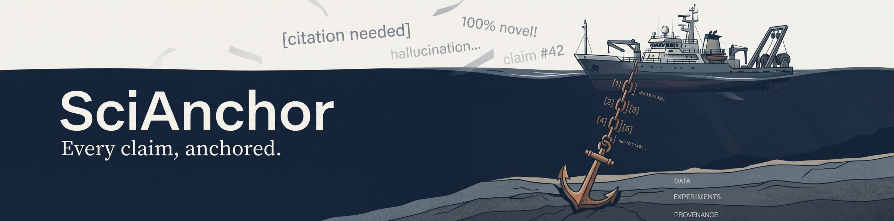
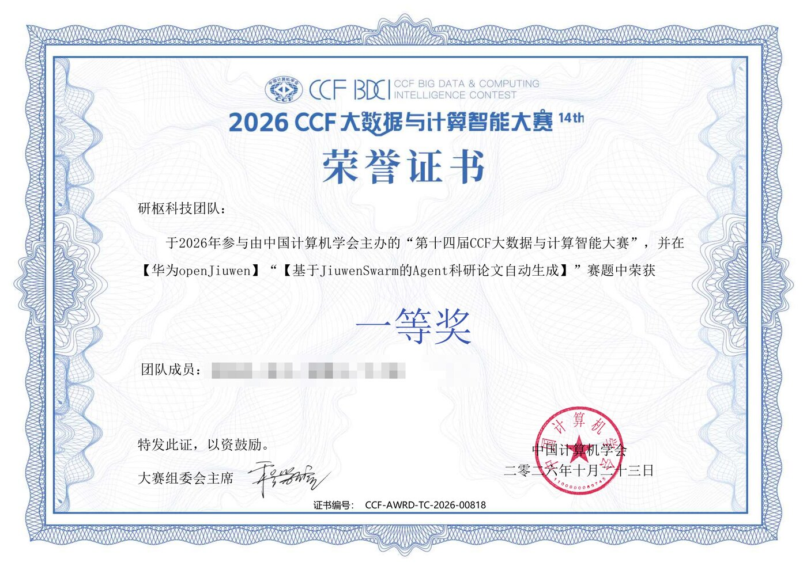

<p align="center">
  
</p>

<p align="center">
  <a href="README.md">简体中文</a> · <a href="README.en.md"><b>English</b></a>
</p>

<p align="center">
  <a href="LICENSE"></a>
  
  
  
  
</p>

<h3 align="center">Reliability first: a research co-pilot agent for the LLM era</h3>

<p align="center"><b>Trustworthy</b> · <b>Cross-disciplinary</b> · <b>Controllable</b></p>

SciAnchor is an open-source research co-pilot agent. Researchers focus on the scientific question and the key judgments; SciAnchor handles literature review, experiment analysis, writing, and review-and-revision. It covers the whole workflow, **topic → literature → data analysis → writing → review → revision**: every number traces back to its source, every citation resolves to a real paper, every "pass" comes with evidence, and the researcher can take over at any point.

SciAnchor works with Codex, Claude Code, Gemini CLI, OpenCode, Cursor Agent and other mainstream agents, and runs on Huawei openJiuwen / JiuwenSwarm.

## 🏆 First Prize, CCF BDCI 2026

SciAnchor won **First Prize at the 14th CCF Big Data & Computing Intelligence Contest (BDCI 2026)**, ranking **1 of 1,447**, in the Huawei openJiuwen track "Automated research paper generation with JiuwenSwarm agents". The certificate was issued by the China Computer Federation (No. CCF-AWRD-TC-2026-00818).

<p align="center">
  
</p>

The contest paper, *SciRigorBench: Provable and Automated Evaluation of Long-Horizon Research Agents via Hierarchical Sequential Testing*, was generated by SciAnchor in a single launch with no human intervention:

| Scored by Stanford Agentic Reviewer (ICLR scale, out of 10) | Score |
|---|---|
| **SciAnchor contest paper** | **7.30** (recommend acceptance) |
| Top-venue acceptance line (ICLR) | 5.39 |
| FARS fully automated research system, mean of 100 papers | 5.05 |
| Human submissions, mean | 4.21 |

<sub>7.3 is the single-paper score from paperreview.ai, verdict "I recommend acceptance."; 5.39, 5.05 and 4.21 come from data published for the 2026 CCF BDCI track.</sub>

## Results

| | |
|---|---|
| **A full paper from one launch** | 35-page ICLR-template paper (8 data figures, 14 tables) in 64 minutes; 561 model calls, 0 failures, 0 manual TeX edits |
| **Checkable numbers and citations** | Every result number is printed through a macro traceable to the script that produced it; one command re-runs without the model and reproduces every number byte for byte |
| **Auditors certify themselves first** | Planted defects caught 20/20, false-accusation upper bound 0.081; an auditor must pass statistical certification before delivery |
| **Cross-disciplinary output** | 80+ papers produced across 26 first-level disciplines |
| **Research corpus** | 735K exemplar papers from CCF-A/B venues and top-tier journals; 288K public peer reviews distilled into 1,803 defect sub-questions; 1,740 human feedback items, 183 gated into the experience bank |

## Three Principles

**Trustworthy: real literature + real data, both traceable**
Citations resolve to real papers (search via OpenAlex, Semantic Scholar, Crossref, PubMed, arXiv and more); numbers link back to raw data and code. Judgments, versions and every model call are logged, meeting funder verification and institutional record-keeping requirements.

**Cross-disciplinary: research in natural language**
Built-in writing norms for five discipline families: STEM, biomedical, social science, humanities, and law & policy. Before writing, SciAnchor retrieves strong published papers in the same area as exemplars and learns only their structure and moves, never their wording or conclusions.

**Controllable: join at any stage, the researcher stays in charge**
Start from an idea, a literature set, existing data, a draft, or reviewer comments. SciAnchor pauses at key decisions for the researcher, and stage transitions are decided by gates, not by the model grading itself.

## Quick Start

```bash
git clone https://github.com/SciAnchor/SciAnchor.git
cd SciAnchor
./setup.sh
rh --json doctor            # verify the install
rh skill bootstrap          # install skills for Codex and Claude Code
```

Claude Code users also attach the MCP tools (Codex picks them up from the checked-in `.codex/config.toml`):

```bash
claude mcp add research-harness \
  --env RESEARCH_HARNESS_DB_PATH="$PWD/.research-harness/pool.db" \
  -- python -m research_harness_mcp
```

Then hand this to your agent:

```text
First read docs/AGENT_OPERATIONS.md.
Using checkpoint interaction mode, create a research topic on
"robust budget pacing for online advertising", search and ingest recent papers,
and build a first literature map. Pause and ask me at key decision points.
```

Full deployment and a human-in-the-loop walkthrough: [docs/deploy-and-hitl.zh.md](docs/deploy-and-hitl.zh.md). More in the [Quickstart](docs/quickstart.md).

## What It Does

SciAnchor covers the whole research workflow. Use any step on its own, or join at any step and carry the project through to a finished manuscript.

| Stage | Capabilities | Entrypoints |
|---|---|---|
| **Topic Selection** | Topic framing and field briefs; generate and rank research directions; crowdedness ("red ocean") assessment by method, task and area; originality-boundary checks against prior work; GO / NO-GO project certification | `/research-init` `/project-novelty-certification` `topic_init` `topic_framing` `field_brief` `direction_ranking` `compute_method_red_ocean` `originality_boundary_check` |
| **Literature Search** | Multi-source search over arXiv, OpenAlex, Semantic Scholar, Crossref and PubMed with merging and de-duplication; iterative query refinement; forward and backward citation expansion; open-access PDF download and full-text parsing; existence and metadata verification so no cited paper is fabricated | `/literature-search` `/citation-trace` `/paper-verify` `paper_search` `paper_ingest` `query_refine` `iterative_retrieval_loop` `expand_citations` `paper_acquire` |
| **Literature Synthesis** | Literature maps and method taxonomies; reading order ranked by relevance, citations and recency; deep reading that extracts claims, assumptions, limitations, datasets and metrics; table extraction and figure interpretation; cross-paper evidence matrices and contradiction detection | `/literature-mapping` `/claim-extraction` `paper_summarize` `claim_extract` `evidence_link` `deep_read` `method_taxonomy` `reading_prioritize` `table_extract` `figure_interpret` `evidence_matrix` `contradiction_detect` |
| **Idea Discovery** | Evidence-based research-gap detection with cross-checks against the source text; key-baseline identification; adversarial argument over candidate directions; candidate algorithm generation and iterative design | `/gap-analysis` `gap_detect` `baseline_identify` `adversarial_review` `gap_cross_verify` `gap_ground_verify` `algorithm_candidate_generate` `algorithm_design_loop` |
| **Experiment Design** | Expand a direction into a formal design brief; experiment-design checklist (baselines, datasets, metrics, ablations, reproducibility, case and failure analysis), pre-filled from the topic's literature | `/rh-paper-perfection` `design_brief_expand` `experiment_design_checklist` `dataset_index` |
| **Experiment Execution** | Experiment code generation and validation; running experiments, collecting results and iterating; experiment logs and metric aggregation; result numbers registered as verified values for the manuscript to cite | `/rh-paper-perfection` `code_generate` `code_validate` `experiment_run` `experiment_loop` `experiment_log` `metrics_aggregate` `verified_registry_build` |
| **Figures** | Method architecture diagrams and schematics; analysis figures rendered from raw experiment records in discipline-specific styles; whole-paper figure planning; figure quality checks (resolution, placeholders, font size, color) | `/rh-paper-figure-generator` `/figure-quality` `figure_generate` `figure_suite_plan` `figure_suite_render` `figure_package` |
| **Paper Writing** | Six manuscript types: research paper, survey, system/benchmark, short/workshop paper, position paper, research report; outline and writing-architecture planning; exemplar-anchored writing; evidence-grounded section drafting; writing norms for five discipline families; math-notation formalization; whole-manuscript terminology and notation unification; a logic gate before drafting | `/paper-writing` `/section-drafting` `/rh-exemplar-writing` `/domain-writing-*` `/manuscript-math-formalization` `/manuscript-logic-gate` `section_draft` `exemplar_retrieve` `exemplar_plan` `exemplar_generate` `outline_generate` `manuscript_unify` |
| **Polishing** | Section-by-section language polishing behind an invariant gate: numbers, citations, cross-references, figures and length must not change, otherwise the original section is kept | `manuscript_polish` `exemplar_critique` |
| **Peer Review** | Simulated peer review (multi-dimension reviewer panel checked against a defect tree distilled from public reviews); whole-manuscript issue audit; citation verification and cleanup; checking every number in the text against its source; venue format compliance; section-level revision adopted only if re-review does not score lower; rebuttal drafting | `/manuscript-issue-audit` `/evidence-gating` `manuscript_review` `consistency_check` `advisory_check` `section_review` `section_revise` `citation_verify` `paper_verify_numbers` `venue_compliance_check` `rebuttal_format` |
| **End-to-End Orchestration** | One-command paper generation; project progress, gate status and next steps at any time; pauses at key decisions for the researcher; resume from checkpoints after interruption; full provenance and replay; researcher feedback and failure lessons stored as experience so later projects avoid them | `/rh-write` `/rh-status` `/rh-decide` `/rh-continue` `/provenance-review` `/rh-self-evolution` `paper_production_start` `orchestrator_status` `orchestrator_gate_check` `paper_production_decide` `provenance_summary` |

<sub>Entrypoints: `/name` is a skill you call directly in Codex, Claude Code and other agents; the rest are MCP tools or research primitives that agents call as needed, and that you can also run with `rh primitive exec <name>`. Full lists: [MCP tools](docs/mcp-tools.zh.md) and [skills/manifest.json](skills/manifest.json).</sub>

## Documentation

[Quickstart](docs/quickstart.md) · [Agent guide](docs/agent-guide.md) · [MCP tools](docs/mcp-tools.zh.md) · [Architecture](docs/architecture.md) · [Status](docs/STATUS.md) · [Release boundary](docs/contracts/release-boundary.md) · [Troubleshooting](docs/TROUBLESHOOTING.md)

## Team

SciAnchor is developed and maintained by Zhice Technology (Beijing) Co., Ltd. Core team members come from Peking University School of Computer Science, Peking University Health Science Center, and Communication University of China, spanning AI, clinical medicine and data engineering.

## License

[GNU AGPL-3.0](LICENSE). Personal, academic and internal institutional use is unrestricted; if you distribute a modified version or offer it as a network service, you must release the complete source under AGPL-3.0. A commercial license is available for closed-source or commercial use; see [NOTICE](NOTICE). Third-party licenses: [THIRD_PARTY_NOTICES.md](THIRD_PARTY_NOTICES.md).
