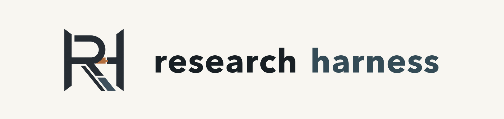

<p align="center">
  
</p>

<p align="center">
  <a href="README.md">简体中文</a> · <a href="README.en.md"><b>English</b></a>
</p>

<p align="center">
  <a href="LICENSE"></a>
  
  
</p>

<p align="center"><strong style="font-size:1.75rem;">Evidence-grounded, traceable, self-improving long-horizon AI research automation</strong></p>

<p align="center">The <b>SciAnchor</b> repository · home of <b>Research Harness</b>, its open-source research engine (desktop and web clients coming soon)</p>

Research Harness is the harness layer for research agents: it gives agents evidence state, process records, tool interfaces, and feedback loops so search, reading, judgment, and writing become a long-running, continuously accumulating automated research workflow.

It works with Codex, Claude Code, Gemini CLI, OpenCode, Cline, Cursor Agent, Kilo Code, and other mainstream AI coding agents. Third-party agent tools such as OpenClaw can integrate through RH agent profiles.

For current subsystem status and the public MCP surface, see [docs/STATUS.md](docs/STATUS.md).
For the current pre-release boundary, see
[Release boundary](docs/contracts/release-boundary.md).

## Current Release Boundary

RH's stable commitment is the local public CLI/MCP/skills workflow. The HTTP
bridge is a local/internal loopback integration surface, not a stable external
API release. Zotero is stable only for local `direction=push`, `dry_run=true`
validation. Fake/sandbox pull/both and apply evidence is local gate evidence
only; Real Zotero network sync/apply remains deferred. Benchmark and performance
evidence is private local regression governance only; Public benchmark/performance
claims remain deferred.

## 3-Minute First Run

**1. Install RH itself**

```bash
git clone https://github.com/scianchor/scianchor.git
cd scianchor
./setup.sh
rh --json doctor            # verify it runs (check state_trees points at one pool.db)
```

Optional: install paperfetch (fetches and verifies open-access PDFs, parses full text; needs Python 3.12). RH detects its `spc` command automatically:

```bash
pip install -e packages/paperfetch
```

**2. Deploy into your agent** (both Codex and Claude Code)

```bash
rh skill bootstrap          # install + verify skills for Codex and Claude Code in one command

# Codex: MCP is auto-mounted from the checked-in .codex/config.toml — no extra setup
# Claude Code: attach RH's MCP tool surface
claude mcp add research-harness \
  --env RESEARCH_HARNESS_DB_PATH="$PWD/.research-harness/pool.db" \
  -- python -m research_harness_mcp
```

> Full deployment steps plus a complete conversational human-in-the-loop walkthrough
> (open topic → checkpoint decision → continue → draft → feedback rework) are in
> **[docs/deploy-and-hitl.zh.md](docs/deploy-and-hitl.zh.md)**.

**3. Hand it to your agent**

Give this prompt to Codex, Claude Code, or another agent with RH installed:

```text
First read docs/AGENT_OPERATIONS.md (RH's L0 entry point).
Using checkpoint interaction mode, create a research topic on
"robust budget pacing for online advertising", search recent papers, ingest the
useful ones, and generate a first literature map.
Every paper must be ingested with a topic; record key outputs as RH artifacts,
and pause at key decision points to ask me.
```

Without an API key, you can still run installation checks, install skills, inspect the public entrypoints, and read the local demo story. Configure an LLM route when you want deep read, claim extraction, annotation, or other model-backed primitives.

## Why RH

General-purpose agents can already search papers, summarize PDFs, extract ideas, and draft text. The hard part is making those actions accumulate. After one conversation ends, papers, claims, gaps, baselines, experiment decisions, and draft versions often remain scattered across chat logs, scratch files, and human memory. Research Harness closes that break: it turns research from one-off answers into evidence-backed, traceable, resumable, and improvable research assets.

## Product Principles

| Principle | Description |
|---|---|
| **Evidence-grounded** | Link papers, evidence spans, and provenance to reduce unsupported reasoning. |
| **Traceable Process** | Record judgments, stages, versions, and gates for replay, review, and resumption. |
| **Self-improving Loop** | Carry failures, fixes, conflicts, and feedback into later evidence-based iterations. |
| **Long-horizon Work** | Support continuous research automation across sessions, tools, and agents. |

## Five Public Entrypoints

RH public skills are grouped by task suites. `skills/manifest.json` exposes `public_suite`, `task_type`, `data_access_level`, inputs, outputs, gates, artifact schemas, and rough runtime for every skill, so agents and UIs can collapse the full tool surface into a few understandable entrypoints.

| Entrypoint | Use it for | Representative skills |
|---|---|---|
| **research** | Topic setup, literature search, mapping, claim extraction, gap analysis | `research-init`, `literature-search`, `literature-mapping`, `claim-extraction`, `gap-analysis` |
| **paper** | Section drafting, figure quality, publication or review packages | `paper-writing`, `section-drafting`, `figure-quality`, `publication-pack` |
| **review** | Paper identity checks, evidence gates, provenance audits | `paper-verify`, `evidence-gating`, `provenance-review` |
| **zotero** | Zotero sync, local PDF reading, plugin adapter work | `paper-sync`, `paper-reading-annotation`, `rh-zotero-plugin-adapter` |
| **benchmark** | Final-bundle evaluation, runtime-contract replay, self-improvement support | `final-bundle-quality`, `task-taxonomy` |

## Core Capabilities

| Capability | Description |
|---|---|
| 🔎 **Paper Pool Management** | Search, filter, and ingest papers around a research topic, maintaining an extensible topic-level literature pool. |
| 🧾 **Claim Extraction** | Extract research claims, assumptions, limitations, datasets, metrics, and reproducibility risks from papers. |
| 🧭 **Provenance Tracking** | Track relationships between papers, claims, evidence, artifacts, and stage decisions so conclusions remain inspectable. |
| 🧪 **Gap & Baseline Analysis** | Identify research gaps, key baselines, method conflicts, and experiment directions worth pursuing. |
| 📝 **Evidence-Constrained Drafting** | Generate experiment briefs, proposals, related work, or section drafts while preserving evidence links. |
| 🚦 **Stage Orchestration & Gates** | Manage long-running research with stage state, gate checks, consistency checks, and recorded artifacts. |
| 🔁 **Self-improvement Loop** | Write failure causes, review feedback, contradictions, and revisions back into research state for later iterations. |
| 📚 **Zotero Reading Workflow** | Use Zotero libraries, PDFs, and reading context as an entry point into RH research state. |
| 🔌 **Multi-agent Interface** | Support mainstream AI coding agents and third-party agent tools through RH agent profiles. |

## Install Notes

Install an AI coding agent you already use. The example below uses Codex:

```bash
npm install -g @openai/codex
```

Then give Codex this prompt:

```text
Please install SciAnchor (the Research Harness engine) for the current environment:

1. Clone the repository: https://github.com/scianchor/scianchor.git
2. Enter the project directory and run ./setup.sh
3. Run rh --json doctor to verify the installation
4. Install RH skills for Codex: rh skill install --agent codex
5. Run rh skill verify --agent codex to verify the skills
6. If any step fails, diagnose and fix it before continuing; do not skip failed steps
```

Manual installation, model routes, and MCP setup are documented here:

- [Codex / Claude Code deployment + conversational HITL](docs/deploy-and-hitl.zh.md)
- [Quick Start](docs/quickstart.md)
- [中文快速开始](docs/quickstart.zh.md)
- [Demo story](docs/DEMO.md)
- [Showcase bundle](docs/showcase-bundle.md)

## Scenarios

Each scenario below is a prompt you can give directly to an agent. RH organizes the work through structured topic, paper pool, claim, gap, artifact, and provenance state instead of producing a one-off chat answer.

**Create a research topic from scratch**

**Prompt**

```text
Create a research topic on "robust budget pacing for online advertising".
Search recent papers, ingest the useful ones, and build a first literature map.
```

**How RH handles it**: creates the topic, searches and ingests papers, maintains the paper pool, and records the literature map as resumable research output.

---

**Turn reading into evidence assets**

**Prompt**

```text
Deep-read the most relevant papers in this topic.
Extract research claims, key assumptions, limitations, datasets, metrics, and reproducibility risks.
```

**How RH handles it**: runs deep reading and claim extraction, writes claims, assumptions, limitations, and risks into topic state, and preserves source links.

---

**Converge from evidence to experiments**

**Prompt**

```text
Identify research gaps from the recorded evidence.
Compare relevant baselines and generate an experiment brief for the strongest direction.
```

**How RH handles it**: uses the ingested papers and extracted claims to identify gaps and baselines, then records an evidence-constrained experiment brief.

---

**Draft reviewable writing**

**Prompt**

```text
Draft a related-work section from the current topic's paper pool and claims.
Keep evidence sources attached to every key conclusion.
```

**How RH handles it**: assembles writing context from the paper pool, claims, and provenance records to generate a traceable section draft.

## Interfaces

| Interface | Best for | Docs |
|---|---|---|
| **Zotero panel** | Paper-first local research workflows | [docs/zotero-rh-panel.md](docs/zotero-rh-panel.md) |
| **MCP / agent clients** | Codex, Claude Code, Gemini CLI, OpenCode, Cline, Cursor Agent, Kilo Code, and similar agent workflows | [docs/agent-guide.md](docs/agent-guide.md) |
| **CLI** | Terminal workflows, scripts, and automation | [docs/quickstart.md](docs/quickstart.md) |
| **Python API** | Notebooks, pipelines, and programmatic integrations | [docs/python-api.md](docs/python-api.md) |

## Open Source Maintenance With Codex

SciAnchor uses Codex as part of its own open-source maintenance workflow: generating and reviewing tests, replaying regressions, checking release hygiene, updating documentation, reviewing MCP / CLI / Zotero bridge changes, and supporting pre-merge security review. RH is designed to record the judgments, failures, fixes, and evidence behind those maintenance steps instead of leaving them as one-off agent transcripts.

For open-source maintainers, RH provides a transferable agent workflow: Codex performs implementation and verification, while RH manages papers, claims, artifacts, gates, provenance, and long-running task state so complex research projects remain traceable, resumable, and reviewable across tools and sessions.

## Documentation

- [Docs index](docs/index.md)
- [Quick Start](docs/quickstart.md)
- [Codex / Claude Code deployment + conversational HITL](docs/deploy-and-hitl.zh.md)
- [Agent Guide](docs/agent-guide.md)
- [Paper Management (Chinese)](docs/paper-management.zh.md)
- [MCP tools and workflows (Chinese)](docs/mcp-tools.zh.md)
- [Zotero integration (Chinese)](docs/zotero-integration.zh.md)
- [Architecture](docs/architecture.md)
- [Troubleshooting](docs/TROUBLESHOOTING.md)
- [Tool Support Matrix](docs/tool-support.md)
- [Security Policy](SECURITY.md)

## License

[GNU AGPL-3.0](LICENSE). Personal, academic and in-house use is unrestricted; if you distribute a modified version or offer RH as a network service, you must release the complete source under AGPL-3.0. For closed-source or commercial use, a commercial license is available; see [NOTICE](NOTICE). Third-party code keeps its own license; see [THIRD_PARTY_NOTICES.md](THIRD_PARTY_NOTICES.md).
