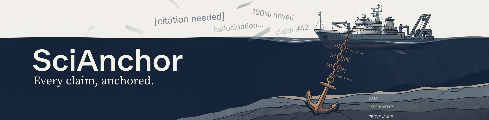
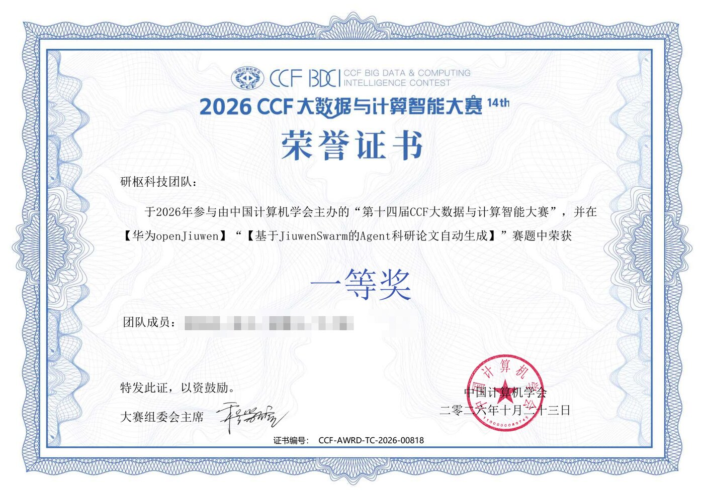

<p align="center">
  
</p>

<p align="center">
  <a href="README.md"><b>简体中文</b></a> · <a href="README.en.md">English</a>
</p>

<p align="center">
  <a href="LICENSE"></a>
  
  
  
  
</p>

<h3 align="center">以可靠为第一原则，构建大模型时代的科研协同智能体</h3>

<p align="center"><b>高可信</b> · <b>跨学科</b> · <b>强可控</b></p>

SciAnchor 是一个开源的科研协同智能体：学者聚焦科学问题与核心判断，文献调研、实验分析、论文写作与审稿返修交给 SciAnchor。它贯通**选题 → 文献 → 数据分析 → 写作 → 审稿诊断 → 返修**全流程，每个数字能回查，每条引用能对回原文，每一个"通过"背后都有证据，学者随时可以接管。

可接入 Codex、Claude Code、Gemini CLI、OpenCode、Cursor Agent 等主流 agent，也可在华为 openJiuwen / JiuwenSwarm 上运行。

## 🏆 CCF BDCI 2026 一等奖

SciAnchor 获 **第十四届 CCF 大数据与计算智能大赛（BDCI 2026）一等奖**，赛事排名 **1 / 1,447**。赛题为华为 openJiuwen「基于 JiuwenSwarm 的 Agent 科研论文自动生成」，证书由中国计算机学会颁发（编号 CCF-AWRD-TC-2026-00818）。

<p align="center">
  
</p>

参赛论文 *SciRigorBench: Provable and Automated Evaluation of Long-Horizon Research Agents via Hierarchical Sequential Testing* 由 SciAnchor 一次启动、全程无人干预生成：

| 评分对象（Stanford Agentic Reviewer，ICLR 尺度，满分 10） | 分数 |
|---|---|
| **SciAnchor 参赛论文** | **7.30**（推荐接收） |
| 国际顶会录用线（ICLR） | 5.39 |
| 全自动科研系统 FARS 百篇均分 | 5.05 |
| 人类投稿均分 | 4.21 |

<sub>7.3 为参赛论文在 paperreview.ai 的单篇评分，官方结论 "I recommend acceptance."；5.39、5.05、4.21 出自 2026 CCF BDCI 赛题公布数据。</sub>

## 实际成果

| | 成果 |
|---|---|
| **一次启动出整篇论文** | 64 分钟产出 35 页 ICLR 模板英文论文（8 张数据图、14 张表），561 次模型调用 0 失败，手改 TeX 0 处 |
| **数字与引用可核对** | 正文每个结果数字经宏打印、可追溯到生成脚本；一条命令免模型重跑，论文全部结果数字逐字节一致 |
| **审计器先自证** | 随机植入缺陷 20/20 检出，误指控上界 0.081，审计器通过统计认证后才允许交付 |
| **跨学科出稿** | 已出稿 80+ 篇论文，覆盖 26 个一级学科 |
| **科研语料** | 73.5 万篇 CCF-A/B 与中科院一二区范文；28.8 万份公开审稿意见归纳为 1,803 个缺陷子问题；1,740 条人类反馈，183 条经验门控入库 |

## 三大特性

**高可信：真文献 + 真数据双溯源**
引用对回真实文献（检索接入 OpenAlex、Semantic Scholar、Crossref、PubMed、arXiv 等），数字回链原始数据与代码；判断、版本与每一次模型调用全程留痕，满足基金核实与高校留痕要求。

**跨学科：用自然语言完成科研**
内置 STEM、生物医学、社会科学、人文、法政五大学科族写作规范；写作前检索同类高水平论文做范文锚定，只学结构与写法，不取措辞与结论。

**强可控：任意阶段介入，学者随时主导**
仅有想法、已有文献、已有数据、已有初稿或审稿意见，都可以从当前阶段接着推进；关键节点停下由学者拍板，阶段推进由门控决定，而不是模型自评。

## 快速开始

```bash
git clone https://github.com/SciAnchor/SciAnchor.git
cd SciAnchor
./setup.sh
rh --json doctor            # 确认安装成功
rh skill bootstrap          # 为 Codex 与 Claude Code 安装 skills
```

Claude Code 用户再挂上 MCP 工具（Codex 已由仓库内 `.codex/config.toml` 自动挂载）：

```bash
claude mcp add research-harness \
  --env RESEARCH_HARNESS_DB_PATH="$PWD/.research-harness/pool.db" \
  -- python -m research_harness_mcp
```

然后把下面这段交给你的 agent：

```text
先读 docs/AGENT_OPERATIONS.md。
用 checkpoint 交互模式，围绕「robust budget pacing for online advertising」创建研究课题，
检索近期论文、筛选入库，并生成第一版文献地图；遇到关键决策点停下来问我。
```

完整部署与人在环操作实录见 [docs/deploy-and-hitl.zh.md](docs/deploy-and-hitl.zh.md)，更多说明见 [中文快速开始](docs/quickstart.zh.md)。

## 能做什么

覆盖科研全流程，每个环节都可以单独使用，也可以从任意环节接入、一路推进到投稿。

| 环节 | 功能 |
|---|---|
| **选题与开题** | 课题框定与领域速览；研究方向生成与排序；方法、任务、领域三个维度的拥挤度（红海）评估；新颖性边界检查与 GO / NO-GO 立项认证 |
| **文献检索** | arXiv、OpenAlex、Semantic Scholar、Crossref、PubMed 多源检索与合并去重；检索词迭代改写；沿参考文献与被引前后向扩展；开放获取 PDF 下载与全文解析；论文真实性与元数据核验，杜绝"查无此文" |
| **文献梳理** | 文献地图与方法分类体系；按相关度排定精读顺序；逐篇精读，提取研究声明、假设、局限、数据集与指标；论文表格抽取；跨论文证据矩阵与观点矛盾发现；领域代表作识别 |
| **创新点发现** | 基于证据识别研究空白，并做交叉验证与回原文核实；关键基线识别；候选创新方向生成、对抗式论证与排序；算法方案设计与迭代 |
| **实验设计与执行** | 实验设计检查清单（对照、消融、统计功效等）；实验代码生成与校验；实验运行、结果回收与多轮迭代；实验日志与指标汇总；结果数字登记为已核验数字，供正文引用 |
| **科研绘图** | 方法架构图与示意图生成；由原始实验记录渲染实验分析图，多学科图表样式；图表质量检查（分辨率、占位图、字号、配色）；图表解读文字生成 |
| **论文写作** | 支持专项研究、综述、系统/基准、短论文、立场论文、科研汇报六类文稿；大纲与写作架构规划；范文锚定写作；按证据逐节起草；五大学科族写作规范；数学符号规范化；全文术语与符号统一；写作前逻辑门检查 |
| **润色** | 逐节语言润色，并用不变量门控保证数字、引用、交叉引用、图表与篇幅不被改动，改坏即回退原文 |
| **审稿与返修** | 模拟同行审稿（多维审稿组，对照由公开审稿意见归纳的缺陷树找硬伤）；投稿前全文问题排查；引用核验与清洗；正文数字回查核验；目标期刊/会议格式合规检查；按审稿意见逐节修订、修订后复审不降分才采纳；Rebuttal 回复撰写 |
| **投稿与交付** | LaTeX 编译；带证据链的投稿材料包；为代码与数据申请 Zenodo DOI |
| **推进与协同（贯穿全程）** | 一句话一键成稿；随时查看课题进度、门控状态与下一步；关键决策点暂停由学者拍板；中断后从检查点续跑；全过程来源追溯与复盘；把学者反馈与失败教训沉淀为经验，后续课题自动规避 |

## 文档

[快速开始](docs/quickstart.zh.md) · [Agent 使用手册](docs/agent-guide.md) · [MCP 工具](docs/mcp-tools.zh.md) · [架构总览](docs/architecture.md) · [当前状态](docs/STATUS.md) · [发布边界](docs/contracts/release-boundary.md) · [故障排查](docs/TROUBLESHOOTING.md)

## 团队

SciAnchor 由执策科技（北京）有限公司开发维护。核心成员来自北京大学计算机学院、北京大学医学部与中国传媒大学，覆盖人工智能、临床医学与数据工程。

## License

[GNU AGPL-3.0](LICENSE)。个人、学术和机构内部使用不受限制；修改后分发或对外提供网络服务时，须以 AGPL-3.0 公开完整源代码。闭源或商业使用可获取商业授权，见 [NOTICE](NOTICE)。第三方代码许可证见 [THIRD_PARTY_NOTICES.md](THIRD_PARTY_NOTICES.md)。
