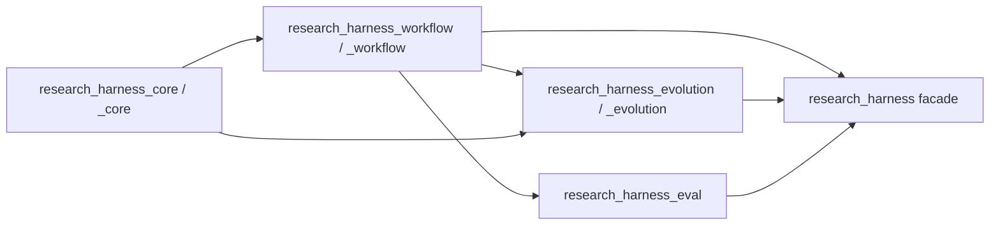

# Research Harness Package Split Plan

Status: staged boundary migration, not a distribution split.
Last verified: 2026-06-02.

The current `research_harness` package is still a monolith. This document is
the target boundary map for the safe intermediate step before separate Python
distributions. The goal is to reduce blast radius without breaking public
imports in the same change that also contracts the MCP and skill surfaces.

## Target Distributions

```text
research_harness_core
  storage/
  provenance/
  capability_registry/
  models/

research_harness_workflow        depends on core
  orchestrator/
  primitives/
  execution/

research_harness_evolution       depends on core + workflow
  topic/
  harness/

research_harness_eval            depends on workflow
  eval/

research_harness                 facade package
  api.py
  cli.py
  service.py
```

## Intermediate Directory Layout

The planned in-package layout is:

```text
packages/research_harness/research_harness/
  _core/
    config.py
    storage/
    core/
    provenance/
    runtime/
    capability_registry/
    models/
  _workflow/
    orchestrator/
    primitives/
    execution/
  _evolution/
    topic/
    harness/
  api.py
  cli.py
  service.py
```

The runtime config, storage, core utility, provenance, and runtime contract
implementations have been physically moved to `_core/config`, `_core/storage`,
`_core/core`, `_core/provenance`, and `_core/runtime` with compatibility shims
at `research_harness.config`, `research_harness.storage`,
`research_harness.core`, `research_harness.provenance`, and
`research_harness.runtime`. The execution backend contract, runtime backend
implementations, backend factory, tracked provenance wrapper, LLM primitive
dispatcher, prompt templates, deterministic writing checks, opt-in DAG
reasoning, claim verification, compiled-summary cache, harness action metadata,
loop controllers, image generation clients, and LaTeX compilation helpers have
started the workflow migration under `_workflow/execution/`. Orchestrator state,
artifact management, gates, transitions, snapshots, reviews, integrity, and
claim helpers have moved under `_workflow/orchestrator`. Compatibility shims
remain at the matching `research_harness.execution.*` and
`research_harness.orchestrator.*` public paths. Provenance recording no longer
imports primitive registry metadata; workflow callers resolve primitive category
metadata before calling the core recorder. Current code still has known reverse
imports such as workflow code importing topic-evolution helpers. Those must be
removed before each directory move, or the move will become a broad import
rewrite with high regression risk.

## Dependency Direction



Allowed imports:

| From | May import | Must not import |
|---|---|---|
| `_core` | stdlib, third-party, `_core` | `_workflow`, `_evolution`, `eval` |
| `_workflow` | `_core`, `_workflow` | `_evolution`, `eval` |
| `_evolution` | `_core`, `_workflow`, `_evolution` | `eval` |
| `eval` | `_core`, `_workflow` | `_evolution` unless a benchmark explicitly tests evolution |
| facade | any internal package | business logic from surfaces |

`scripts/check-architecture-boundaries.py` enforces these directions for any
future directories that exist, plus current non-vacuous guards for the legacy
`_core/`, `core/`, and `storage/` compatibility packages. It also verifies that
completed `_workflow/execution` and `_workflow/orchestrator` slices have public
compatibility shims that alias the canonical module objects. It is included in
`scripts/codex-check.sh --quick`.

## Migration Sequence

1. Keep public imports stable.
2. Break reverse imports in the current monolith:
   - keep primitive metadata lookup outside core provenance recording;
   - move topic-evolution strategy injection behind workflow interfaces;
   - keep evaluator runtime behind `research_harness.evaluator`.
3. Create `_core`, `_workflow`, and `_evolution` directories with compatibility
   re-export modules at old paths. `_core/config`, `_core/storage`,
   `_core/core`, `_core/provenance`, and `_core/runtime` are complete.
   `_workflow/execution/backend`, `_workflow/execution/prompts`,
   `_workflow/execution/writing_checks`, `_workflow/execution/dag_reasoning`,
   `_workflow/execution/claim_verification`, and
   `_workflow/execution/compiled_summary`, plus support slices
   `_workflow/execution/harness_actions`, `_workflow/execution/loops`,
   `_workflow/execution/fal_image_client`, `_workflow/execution/latex_compiler`,
   `_workflow/execution/local`, `_workflow/execution/harness`,
   `_workflow/execution/tracked`, `_workflow/execution/claude_code`, and
   `_workflow/execution/factory`, plus `_workflow/execution/llm_primitives` are
   completed workflow execution slices. `_workflow/orchestrator` is complete for
   orchestrator submodules except the public package facade.
4. Move one ownership group per PR and run the boundary check after each move.
5. After at least four weeks of stable imports, split distributions.

## Current Status

- Evolution now has one root package with `evolution.topic` and
  `evolution.harness`.
- Public MCP and skill surfaces are contracted separately from internal helpers.
- `_core/config` is now the canonical runtime config implementation.
  `research_harness.config` remains as a compatibility shim.
- `_core/storage` is now the canonical storage implementation.
  `research_harness.storage` remains as a compatibility shim for public and
  internal imports.
- `_core/core` is now the canonical home for core utilities such as
  `PaperPool`, `ReviewManager`, `search_cache`, and `circuit_breaker`.
  `research_harness.core` remains as a compatibility shim.
- `_core/provenance` is now the canonical home for provenance data models and
  the recorder. `research_harness.provenance` remains as a compatibility shim.
  Workflow-side `execution.tracked` resolves primitive categories before
  calling the core recorder.
- `_core/runtime` is now the canonical home for `RunSpec`, `RunTrace`,
  `CapabilityManifest`, artifact envelope contracts, and runtime trace grading.
  `research_harness.runtime` remains as a compatibility shim.
- `_workflow/execution/backend` is now the canonical home for `BackendInfo`,
  `ExecutionBackend`, and the exported `PrimitiveResult` contract.
  `_workflow/execution/prompts` is now the canonical home for execution prompt
  templates. `_workflow/execution/writing_checks` is now the canonical home for
  deterministic writing quality checks. `_workflow/execution/dag_reasoning`,
  `_workflow/execution/claim_verification`, and
  `_workflow/execution/compiled_summary` own their corresponding workflow
  helpers. `_workflow/execution/harness_actions`, `_workflow/execution/loops`,
  `_workflow/execution/fal_image_client`, and
  `_workflow/execution/latex_compiler` own execution support helpers.
  `_workflow/execution/local`, `_workflow/execution/harness`,
  `_workflow/execution/claude_code`, `_workflow/execution/factory`, and
  `_workflow/execution/tracked` own runtime backend execution and provenance
  wrapping. `_workflow/execution/llm_primitives` owns the LLM primitive
  dispatcher. The matching `research_harness.execution.*` modules remain as
  compatibility shims and alias to the canonical module objects.
- `_workflow/orchestrator` is now the canonical home for orchestrator models,
  service orchestration, artifact management, stage metadata, transitions,
  snapshots, review, integrity checks, adversarial loops, judge helpers, and
  claim persistence. The matching `research_harness.orchestrator.*` submodules
  remain as compatibility shims and alias to the canonical module objects;
  `research_harness.orchestrator` remains a public facade for top-level exports.
- Remaining `_core/_workflow/_evolution` movement is intentionally deferred
  until reverse-import blockers are removed in small PRs.
